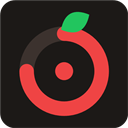

  

<h1 align="center">Focus Mode</h1>

  Pomodoro zamanlayıcısı + odaklanırken dikkat dağıtan siteleri engelleyen Chrome eklentisi. 
  A Pomodoro timer for Chrome that blocks distracting sites while you focus.

  <a href="#türkçe">Türkçe</a> · <a href="#english">English</a>

---

## Türkçe

### Özellikler

- **Pomodoro zamanlayıcısı:** Varsayılan 25 dk odak, 5 dk mola. Süreleri istediğin gibi değiştirebilirsin.
- **Site engelleme:** Odak sırasında seçtiğin siteler açılmaz, yerine kalan süreyi gösteren bir sayfa çıkar.
- **Hazır site listesi:** YouTube, Instagram, X, TikTok, Facebook, Reddit, Netflix, Twitch, Ekşi Sözlük ve daha fazlası. Her birini tek tıkla açıp kapatabilirsin.
- **Kendi siteni ekle:** `ornek.com` yaz ya da linki yapıştır.
- **Odak sırasında mola:** "Mola ver" dersen kalan odak süren saklanır. Mola bitince kaldığın yerden otomatik devam eder.
- **Kendini kandırmak yok:** Odak sürerken açık bir siteyi kapatamazsın.
- **Günlük istatistik:** Kaç dakika odaklandın, kaç pomodoro bitirdin, en çok hangi siteye girmeye çalıştın.
- **Bildirimler** ve ikon üzerinde kalan dakika.
- **Türkçe / İngilizce** arayüz.

### Kurulum

Eklenti henüz Chrome Web Store'da yok, ama birkaç adımda kendi bilgisayarına kurabilirsin:

1. Bu sayfanın üstündeki yeşil **Code** butonuna tıkla, **Download ZIP**'i seç.
2. İnen ZIP dosyasını bir klasöre çıkar. Bu klasörü silme, Chrome eklentiyi oradan çalıştırır.
3. Chrome'da adres çubuğuna `chrome://extensions` yaz.
4. Sağ üstten **Geliştirici modu**nu aç.
5. **Paketlenmemiş öğe yükle**'ye tıkla ve ZIP'ten çıkan klasörü seç (içinde `manifest.json` olan klasör).
6. Araç çubuğundaki yapboz ikonundan 🧩 Focus Mode'u sabitle 📌.

Microsoft Edge, Brave, Opera gibi Chromium tabanlı tarayıcılarda da aynı adımlarla çalışır.

### Güncelleme

Yeni sürümü indirip eski klasörün üzerine çıkar, sonra `chrome://extensions` sayfasında Focus Mode'un **yenile (↻)** butonuna bas. Ayarların ve istatistiklerin silinmez.

### Gizlilik

Focus Mode hiçbir veriyi dışarı göndermez. Ayarlar ve istatistikler sadece senin tarayıcında (`chrome.storage.local`) saklanır. Sunucu, hesap ya da takip yok.

---

## English

### Features

- **Pomodoro timer:** 25 min focus and 5 min break by default, fully adjustable.
- **Site blocking:** While you focus, chosen sites are replaced by a page showing the time left.
- **Ready-made site list:** YouTube, Instagram, X, TikTok, Facebook, Reddit, Netflix, Twitch and more, each with an on/off switch.
- **Add your own sites:** type `example.com` or paste any link.
- **Breaks mid-focus:** "Take a break" saves your remaining focus time, and focus resumes automatically when the break ends.
- **No cheating:** blocked sites can't be switched off during focus.
- **Daily stats:** minutes focused, pomodoros completed, most-attempted site.
- **Notifications** and minutes-left badge on the toolbar icon.
- **English / Turkish** interface.

### Installation

Focus Mode isn't on the Chrome Web Store yet, but you can install it in a few steps:

1. Click the green **Code** button at the top of this page and choose **Download ZIP**.
2. Extract the ZIP into a folder. Keep this folder, because Chrome runs the extension from it.
3. Open `chrome://extensions` in Chrome.
4. Turn on **Developer mode** (top right).
5. Click **Load unpacked** and select the extracted folder (the one containing `manifest.json`).
6. Pin Focus Mode from the puzzle icon 🧩 in the toolbar 📌.

It also works in other Chromium-based browsers such as Microsoft Edge, Brave and Opera.

### Updating

Download the new version, extract it over the old folder, then click Focus Mode's **reload (↻)** button on `chrome://extensions`. Your settings and stats are kept.

### Privacy

Focus Mode sends no data anywhere. Settings and stats are stored only in your browser (`chrome.storage.local`). No servers, no accounts, no tracking.

---

## Destek / Support

Eklentiyi beğendiysen bir kahve ısmarlayabilirsin. If you like it, you can buy me a coffee:

## Lisans / License

[MIT](LICENSE)
